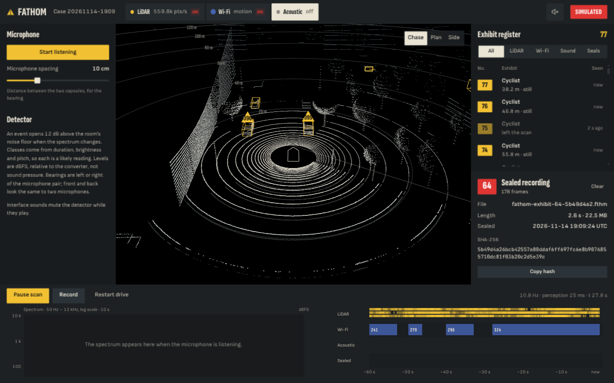
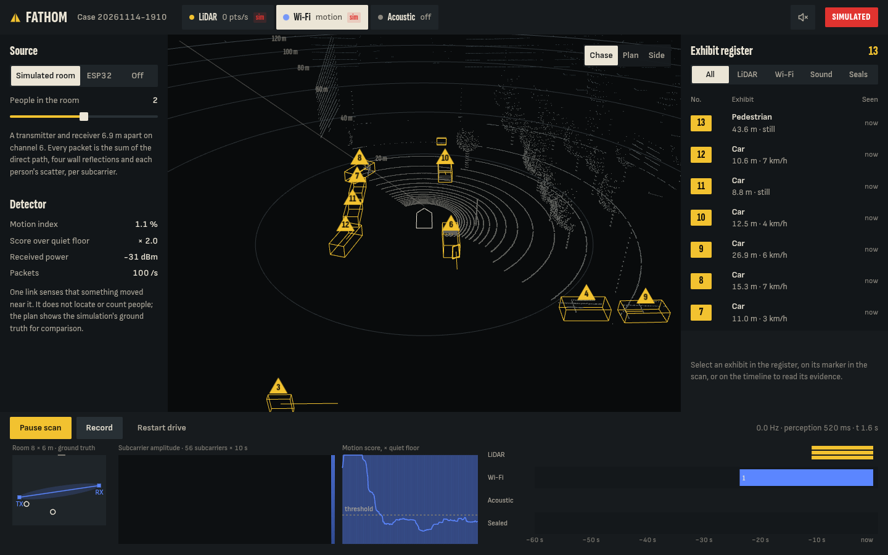

# Fathom

A browser console that handles sensor output the way an evidence unit handles a scene. Three feeds come in:

- a spinning multi-beam **LiDAR**, simulated or real;
- **Wi-Fi channel state** from one radio link, simulated or from an ESP32;
- the **microphone**.

Each feed is turned into detections. Every detection becomes a numbered exhibit with its proof beside it, and every recording is sealed with its SHA-256.



Yellow numbered markers stand on each tracked object in the scan. The same numbers run through the exhibit register and through a 60-second evidence timeline, which has one lane per sensor and draws each bar as long as the exhibit lasted. Seal red is kept for recording and seals, and forensic blue for Wi-Fi. Interface sounds are synthesised, off by default, and mute the microphone detector while they play.



## Feeds

### LiDAR

**Simulated sensor.** Every point is a ray cast from a modelled sensor, fired at its own instant from the pose the vehicle had then, so a moving sensor shows real motion skew.

- Beam layouts of 16, 32, 64 and 128 channels; adjustable rotation rate, maximum range and range noise.
- Whether a ray returns depends on reflectivity, incidence angle, 1/r² falloff and two-way atmospheric extinction. Glass returns only near normal incidence, foliage lets rays through, retroreflective signs saturate.
- Rain and fog thin out distant returns and add droplet returns.
- The scene is a seeded city with buildings, a park, trees, poles, signs, and parked and moving traffic.

**Perception**, in a Web Worker, once per revolution:

1. Ground removal.
2. Clustering on a 0.3 m grid.
3. Box fitting with the closeness criterion of Zhang et al. (2017).
4. Size-based classification.
5. Nearest-neighbour tracking with an alpha-beta filter.

A track becomes an exhibit once eight revolutions have seen it. A track that reappears where an exhibit was lost a moment ago keeps that exhibit's number.

**Real sensors** come in through the bridge (below). The first supported protocol is the Velodyne VLP-16.

### Room scan from an Android phone

On a phone with ARCore depth, **Scan this room** starts a WebXR session:

- Each depth image is unprojected with the camera's projection.
- The points are placed in the room with the phone's tracked pose and thinned on a 2 cm grid.
- They are sent as frames with the scan flag, so the console keeps every point and does not track objects.
- With **Send the scan to the bridge too**, a desktop console connected to the bridge watches the scan arrive live.

On most phones ARCore estimates depth from motion and the camera image; a time-of-flight sensor is not required.

```sh
cd bridge && uv run fathom-bridge --source relay   # relay only, no LiDAR
cd console && bun run dev:phone                    # HTTPS on the local network
```

Open the network address that `dev:phone` prints in Chrome on the phone and accept the self-signed certificate. The page reaches the bridge through the dev server at `wss://<host>/bridge`.

### Wi-Fi channel state

**Simulation.** A transmitter and receiver 6.9 m apart sit in an 8 × 6 m room on channel 6. For every packet, each HT20 subcarrier sums:

- the direct path;
- four first-order wall reflections, by the image method;
- the bistatic scatter off each person, direct and by way of each wall.

A person near the line of sight also shadows it. People standing still keep breathing, which moves the chest by a few millimetres. Receiver noise and automatic gain changes are modelled too.

**ESP32.** Flash a board with Espressif's [esp-csi](https://github.com/espressif/esp-csi) `csi_recv` example, then:

```sh
cd bridge
uv sync --extra csi
uv run fathom-bridge --source relay --csi-serial /dev/ttyUSB0
```

Choose **ESP32** in the console's Wi-Fi feed.

**Detector.** Each packet is divided by its own mean amplitude, which removes the receiver's gain changes. The motion index is the median, over subcarriers, of the one-second coefficient of variation. It is compared with the 10th percentile of the last two quiet minutes. Motion opens at 2.6 times that floor and closes below 1.7 times.

One link senses that something moved near it. It does not locate or count people. The plan in the console shows the simulation's ground truth for comparison, not an estimate.

### Microphone

Blocks of 2048 samples are analysed on every animation frame. The browser's echo cancellation, noise suppression and gain control are switched off.

- **Opening an event:** the level jumps 12 dB above an adaptive noise floor and the spectrum changes (spectral flux).
- **Closing it:** the level falls back.
- **Classes:** clap or knock, thud, footsteps (impulses in a walking rhythm, merged into one exhibit), voice, metallic ring or sustained sound. Each class is a rule on the event's duration, spectral centroid, flatness and voicing, so the console calls it likely.
- **Bearing:** with two input channels, the time difference between them (GCC-PHAT) gives a bearing left or right of the microphone pair. Front and back look the same to two microphones. A mono input reports no bearing.

Levels are dBFS, relative to the converter's full scale; a browser microphone is uncalibrated.

## Seals

**Record** captures every frame the console receives. **Stop and seal** then:

1. writes the frames to one `.fthm` file;
2. computes its SHA-256 in the browser;
3. logs a numbered exhibit with the hash, the frame count, the length and the time it was sealed.

The file name carries the exhibit number and the start of the hash. Open the file again as a sealed recording to replay it at its recorded pace.

## Bridge

```sh
cd bridge
uv run fathom-bridge --source synthetic            # a generated room as VLP-16 packets, no sensor needed
uv run fathom-bridge --source udp                  # a VLP-16 on the network, port 2368
uv run fathom-bridge --source pcap --file run.pcap # replay a capture
uv run fathom-bridge --source relay                # no LiDAR: relay phone scans, forward CSI
```

`--csi-serial PORT` adds an ESP32 to any source. The bridge also rebroadcasts any frame a client sends to every other client, which is how a phone scan reaches a desktop.

The synthetic source and the CSI parser are tested against the documented packet and line formats. Neither has been run against physical hardware yet.

## Frame format

The simulator, the bridge, the phone scan and recordings all use one binary frame, little-endian:

| Offset | Type | Field |
|---|---|---|
| 0 | `u8[4]` | magic `FTHM` |
| 4 | `u16` | version, currently 1 |
| 6 | `u16` | flags: bit 0 simulated, bit 1 end of revolution, bit 2 still scan (keep every point, do not track) |
| 8 | `u32` | frame id |
| 12 | `u32` | point count |
| 16 | `f64` | timestamp, seconds |
| 24 | `f32[3]` | sensor position, metres |
| 36 | `f32` | sensor yaw, radians |
| 40 | 16 bytes per point | `f32` x, y, z in the sensor frame (x forward, y left, z up); `u8` intensity; `u8` ring, 0 = lowest beam; `u16` azimuth in hundredths of a degree |

A recording is a sequence of frames, each preceded by its byte length as a `u32`. The codecs in [console/src/protocol/frame.ts](console/src/protocol/frame.ts) and [bridge/fathom_bridge/frame.py](bridge/fathom_bridge/frame.py) are tested against the same layout.

CSI reaches the console as JSON text messages: `{"type": "csi", "t": seconds, "rssi": dBm, "amp": [per-subcarrier amplitude]}`.

## Running it

```sh
cd console
bun install
bun run dev        # http://localhost:5173
bun run test       # protocol, simulator, perception, Wi-Fi, acoustic and depth tests
bun run build
```

```sh
cd bridge
uv run pytest
```

**Keys:**

- <kbd>Space</kbd> pauses.
- <kbd>1</kbd> <kbd>2</kbd> <kbd>3</kbd> switch the camera between chase, plan and side.
- The arrow keys orbit when the view has focus.
- <kbd>Esc</kbd> clears the selection.

The feed also follows the address: open `#wifi` or `#acoustic` directly.

## Layout

```
console/   Vite, React, TypeScript, three.js
  src/protocol/    FTHM frame codec
  src/sim/         city scene, sensor model, ray caster, worker
  src/perception/  detection and tracking
  src/wifi/        CSI multipath model and motion detector
  src/acoustic/    FFT, GCC-PHAT, sound event analysis, microphone
  src/scan/        WebXR depth scan
  src/audio/       interface sounds
  src/view/        point cloud, range image, Wi-Fi view, spectrogram, evidence timeline
bridge/    Python: VLP-16 parser, packet sources, ESP32 CSI reader, relay, WebSocket server
```

## Status

The LiDAR drive and the Wi-Fi room are simulated, and the console labels them so. The microphone path and the phone scan use real input. No field measurements or benchmarks against physical sensors exist yet.

Neither the phone scan nor the ESP32 path has been run on real hardware:

- **Phone scan:** its unprojection is unit-tested, and its frames were exercised end to end through the bridge with a stand-in client.
- **ESP32:** its serial path was exercised end to end with a stand-in board writing esp-csi lines to a virtual serial port.
