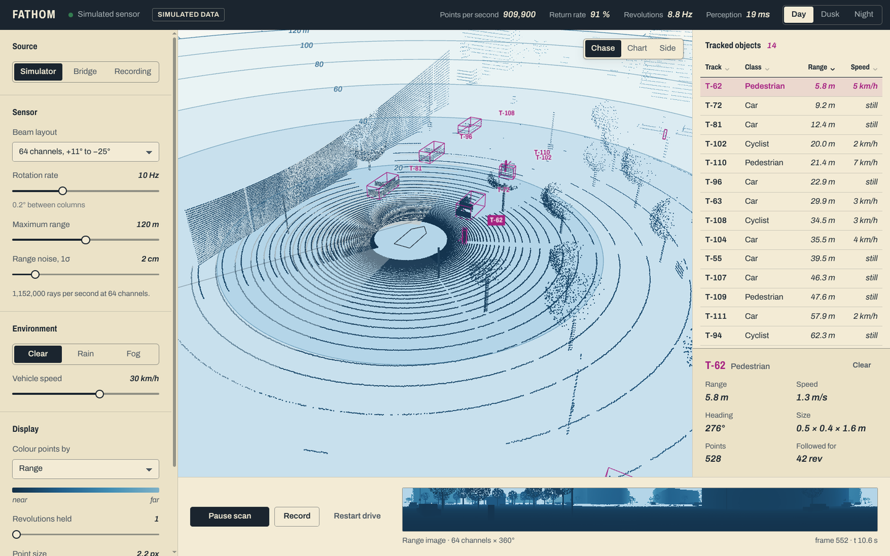
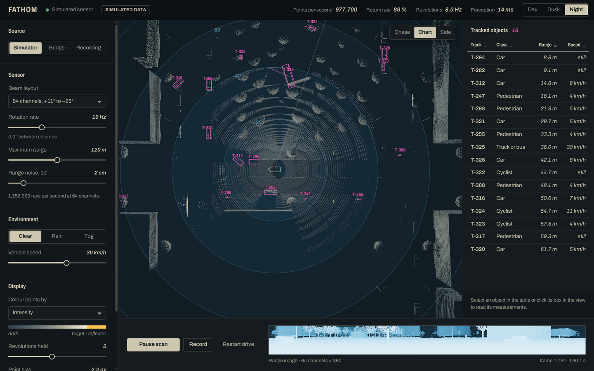

# Fathom

A browser console for a scanning LiDAR. It simulates a spinning multi-beam sensor driving through a city, renders the point cloud live, finds and tracks objects in it, and takes frames from a real sensor through a small Python bridge. Simulated and real data go through the same pipeline.



The interface borrows from the nautical chart. LiDAR is sounding with light, so ground tints step with range, contour rings carry their distances like soundings, and anything the software computed (detections, tracks, selection) is drawn in chart magenta over the measured points. Day, Dusk and Night palettes follow the bridge-display convention.



## What it does

**Simulated sensor.** Every point is a ray cast from a modelled sensor, fired at its own instant from the pose the vehicle had then, so a moving sensor shows real motion skew.

- Beam layouts of 16, 32, 64 and 128 channels; rotation rate, maximum range and range noise are adjustable. A faster spin gives coarser azimuth steps, as on real hardware.
- Whether a ray returns depends on surface reflectivity, incidence angle, 1/r² falloff and two-way atmospheric extinction. Glass returns only near normal incidence, foliage lets rays through, retroreflective signs saturate.
- Rain and fog thin out distant returns and add droplet returns close to the sensor.
- The scene is a seeded city: buildings, a park, street trees, lamp posts and signs, parked cars, and moving cars, trucks, buses, cyclists and pedestrians.

**Perception.** Each revolution is processed in a Web Worker:

1. Ground removal against the lowest return in each 1 m cell's neighbourhood.
2. Clustering of above-ground points on a 0.3 m occupancy grid.
3. Box fitting with the closeness criterion of Zhang et al. (2017), which stays stable on the L-shaped view a LiDAR gets of a vehicle.
4. Size-based classification into car, truck or bus, cyclist and pedestrian.
5. Tracking with nearest-neighbour association and an alpha-beta filter. A track gets a number once three revolutions agree on it.

**Console.** Colour by range, intensity, height, channel or ground truth; hold up to ten revolutions; three camera presets plus free orbit; a sortable track table with per-object range, speed, heading, size and point count; a range image showing the sensor's own view; and recording to `.fthm` files that replay at their recorded pace.

## Hardware

The bridge reads Velodyne VLP-16 data packets and forwards them to the console over WebSocket:

```sh
cd bridge
uv run fathom-bridge --source synthetic            # a generated room, no sensor needed
uv run fathom-bridge --source udp                  # a VLP-16 on the network, port 2368
uv run fathom-bridge --source pcap --file run.pcap # replay a capture
```

Then choose **Bridge** in the console and connect to `ws://127.0.0.1:8765`. The console works out the channel count and range from the frames it receives and fits its views to them.

The synthetic source builds real 1206-byte VLP-16 packets, so it exercises the same parser a live sensor does. It has not been tested against physical hardware yet.

## Frame format

The simulator, the bridge and recordings all use one binary frame, little-endian:

| Offset | Type | Field |
|---|---|---|
| 0 | `u8[4]` | magic `FTHM` |
| 4 | `u16` | version, currently 1 |
| 6 | `u16` | flags: bit 0 simulated, bit 1 end of revolution |
| 8 | `u32` | frame id |
| 12 | `u32` | point count |
| 16 | `f64` | timestamp, seconds |
| 24 | `f32[3]` | sensor position, metres |
| 36 | `f32` | sensor yaw, radians |
| 40 | 16 bytes per point | `f32` x, y, z in the sensor frame (x forward, y left, z up); `u8` intensity; `u8` ring, 0 = lowest beam; `u16` azimuth in hundredths of a degree |

A recording is a sequence of frames, each preceded by its byte length as a `u32`. Encoders in [console/src/protocol/frame.ts](console/src/protocol/frame.ts) and [bridge/fathom_bridge/frame.py](bridge/fathom_bridge/frame.py) are tested against the same layout.

## Running it

```sh
cd console
bun install
bun run dev        # http://localhost:5173
bun run test       # protocol, simulator and perception tests
bun run build
```

```sh
cd bridge
uv run pytest
```

Keys in the console: <kbd>Space</kbd> pauses, <kbd>1</kbd> <kbd>2</kbd> <kbd>3</kbd> switch camera, arrow keys orbit when the view has focus, <kbd>Esc</kbd> clears the selection.

## Layout

```
console/   Vite, React, TypeScript, three.js
  src/protocol/    FTHM frame encoder and decoder
  src/sim/         scene, sensor model, ray caster, worker
  src/perception/  detection and tracking
  src/view/        point cloud renderer, range image, palettes
bridge/    Python: VLP-16 parser, packet sources, WebSocket server
```

## Status

Everything shown in the screenshots is simulated and labelled so in the console. There are no field measurements or benchmarks against real sensors yet.
